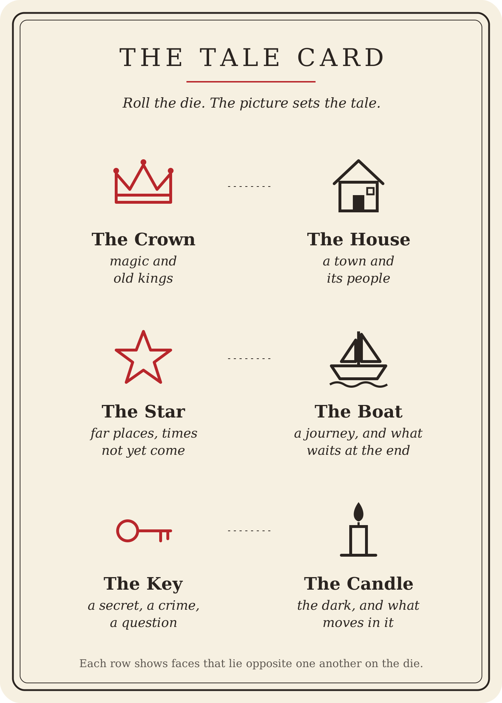
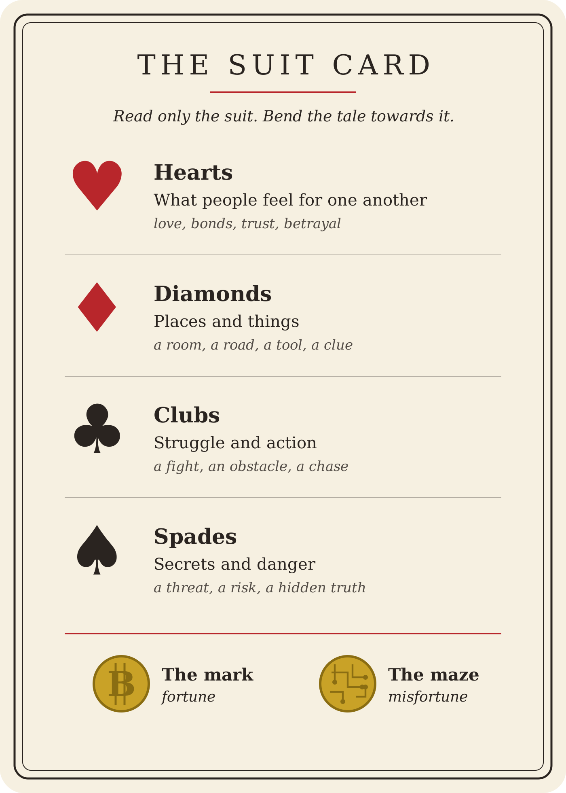
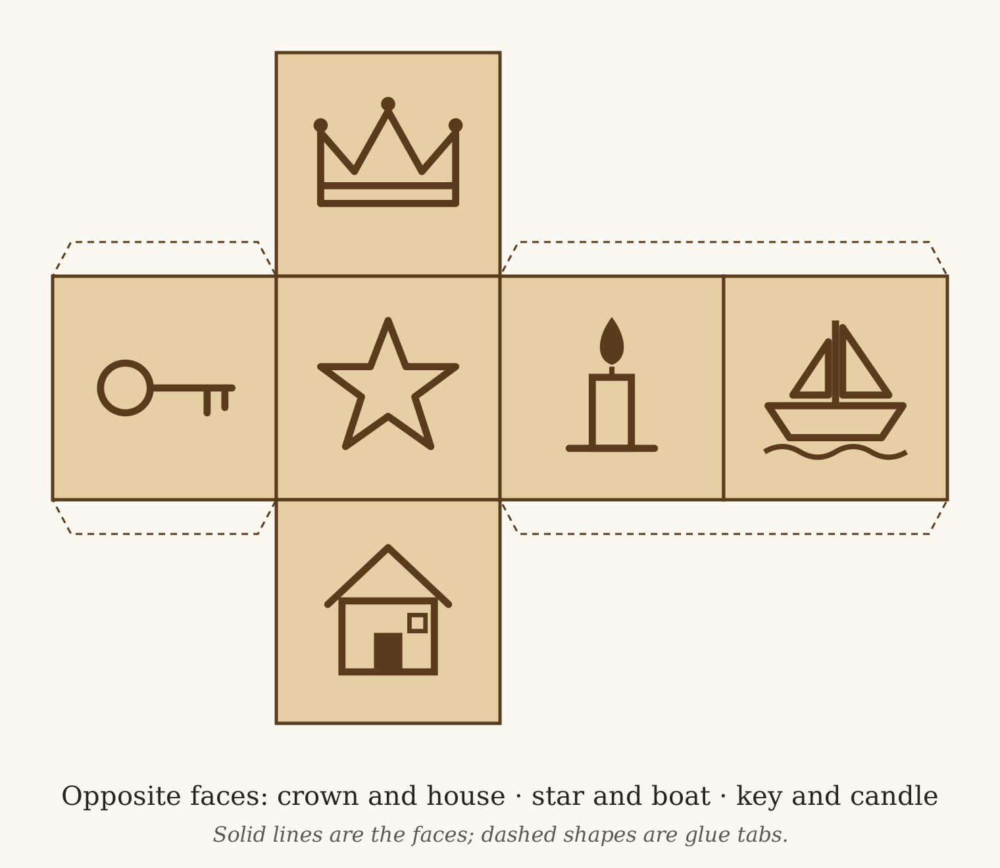

# The Joker's Tale

*A game of memory, fortune and story. No names, no numbers, no score, no winner: a deck, a coin, a die, and a tale waiting to be told.*

## What You Need

**The deck.** A full pack in the old French pattern, with no number printed in the corners, plus a single Joker kept apart. The pips can be seen but are never counted: only the suit is read. The court cards keep their faces. If a card carries a name, it is never read aloud.

**The coin.** An old gold coin with no number and no words. One side shows a worn letter B crossed by strange lines: this is **the mark**, and it means fortune. The other side shows fine traces and dots, like the plan of a city: this is **the maze**, and it means misfortune. Nobody at the table remembers what either side meant once.

**The die.** A wooden cube with a picture on each face instead of pips. The picture sets the kind of tale.

**The prompt cards.** The Tale Card and the Suit Card, laid in the middle of the table for anyone still learning. Once the meanings are known by heart, the cards can be put away.

## The Prompt Cards and the Die

### The Tale Card

Roll the die; the picture sets the kind of tale. Each row of the card pairs faces that lie opposite one another on the die.

### The Suit Card

Read only the suit of each card, and bend the tale towards it. The foot of the card shows the two faces of the coin.

### Making the die

A plain wooden cube with the pictures burned or stamped in suits the game best: handmade, with no maker's mark. The net below shows where each picture goes, so that the opposite faces are paired. It can also be printed on card, cut out, folded and glued as a stand-in until the wooden die is made.

## Laying the Story

Shuffle the deck. Whoever is dealing takes a pinch from it by feel, as much as feels enough for a story, and shuffles the Joker into it. Nobody counts it: nobody knows how long the tale will be, and that is the point. Lay the pinch of cards face down in the middle of the table. The rest of the deck is put away.

## Framing the Tale

The tale is framed in turn, going round to the left.

- **The kind of tale.** Whoever sits nearest the bread rolls the die. The picture that comes up sets the tale.
- **The hero.** The one on their left tosses the coin. The mark: the hero knows this world well, a local or an expert. The maze: the hero is a stranger in it, a newcomer or a novice.
- **The beginning.** The one on their left draws the top card, lays it face up to start the pile, and tosses the coin. Then they tell who the hero is and what has just happened to them, bending the beginning towards the card's suit and the coin's fortune. The telling has begun.

## The Telling

The tale goes round the table, each to the left. On your turn:

- **Draw** the top card and lay it face up on the pile. If it is the Joker, stop: the Finale begins.
- **Toss the coin.** The mark: things go well, a way opens, the hero gains ground. The maze: a setback, a complication, a danger drawing closer.
- **Speak** a breath's worth of tale, no more, carrying on from the last voice and bending the story towards your suit and your fortune.

## The Joker

Whoever draws the Joker becomes the Finisher.

- **Take up the pile** in the order it was laid.
- **Tell the whole tale again** from the beginning, out loud, turning the cards one by one to find your way. If you falter, the others may help softly, with a word or a picture, but nobody tells it for you.
- **Draw a last card,** toss the coin, and bring the tale to its end.

## Customs of the Table

- **No score, no winner.** The tale is the only thing made.
- **No numbers.** Asking how many cards are left, or how long a game takes, earns a warm "No, thank you." A newcomer is taught this by receiving it, never by being corrected.
- **No names.** Characters in the tale may be named by what they do, never by a name. A name lettered on a court card is never read aloud.
- **An unfinished tale.** If the evening ends before the Joker comes, leave the tale where it stands. Next time, someone picks it up from the last card.
- **A new tale.** Gather the pile and the Joker, set the Joker apart, return everything to the deck, and lay a new pinch.

*The Finisher's telling is the oldest part of the game: carrying a whole thing in memory and giving it back aloud, with others there to catch you if you fall. It changes a little each time it is told. Nothing was written down to say it is wrong.*
